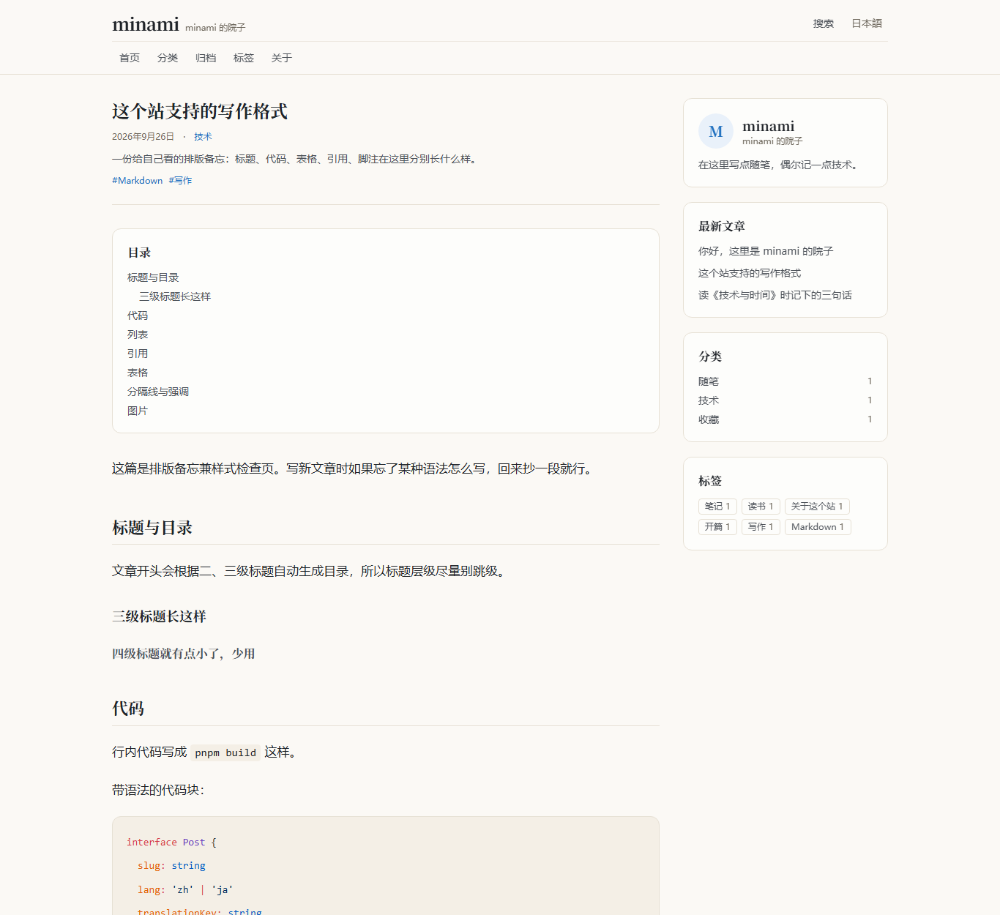

# minami 的院子

一个中日常驻的个人博客。纯静态，用 Markdown 写作，推到 GitHub 就自动发布。
没有数据库、没有后台、没有服务器要续费——**克隆下来就能跑，不用先改配置**。




## 快速开始

需要 Node ≥ 22.12，包管理器用 pnpm。

```bash
pnpm install
pnpm dev        # 本地预览 http://localhost:4321
```

写完之后：

```bash
pnpm build      # 构建到 dist/，同时生成搜索索引
pnpm preview    # 预览构建结果
pnpm check      # 类型与模板检查
```

## 操作流程

### 1. 写一篇文章

在 `src/content/posts/` 下新建一个 `.md`。**文件名不影响网址**，网址由 front matter 里的 `key` 决定：

```markdown
---
lang: zh
key: hello
title: 你好，这里是 minami 的院子
date: 2026-09-28
category: essay
tags:
  - 开篇
description: 列表页与搜索结果上显示的一句话摘要。
---

正文从这里开始。
```

| 字段 | 必填 | 说明 |
| --- | --- | --- |
| `key` | 是 | 文章标识，同时决定网址 `/posts/<key>/`。**中译两版写同一个值** |
| `lang` | 是 | `zh` 或 `ja` |
| `title` | 是 | 标题 |
| `date` | 是 | 写成 `2026-09-28` |
| `category` | 是 | `essay` / `tech` / `collection` |
| `description` | 是 | 摘要 |
| `tags` | 否 | 标签，中/日各写各的 |
| `draft` | 否 | 为 `true` 则只在本地可见，构建时整篇跳过 |

### 2. 想要日文版？

在文章旁边再建一个 `hello.ja.md`，`key` 写一样的值即可。
不要求每篇都翻——**有译文就互相跳转，没有就回到该语言首页**。

### 3. 推送

```bash
git add .
git commit -m "新文章"
git push
```

推送后 GitHub Actions 会自动构建并发布。

### 4. 首次部署（只做一次）

仓库 **Settings → Pages → Build and deployment → Source 选「GitHub Actions」**。

就这一步。部署地址（`site` 与 `base`）由工作流自动推导，**不需要改任何文件**。
如果绑定了自定义域名，在 Settings → Secrets and variables → Actions → Variables 里加
`SITE_URL` 与 `BASE_PATH` 两个变量即可覆盖。

### 5. 图片

图片和文章放一起：建一个与 `key` 同名的文件夹，用相对路径引用。

```markdown

```

构建时会自动压成 WebP、写入 `width`/`height` 并加上懒加载。

## 想改东西，改哪里

| 想改什么 | 改哪里 |
| --- | --- |
| 站名、作者、副标题、简介、导航、分类、语言 | `site.config.ts`（唯一需要改的配置文件） |
| 配色、字体、版心宽、正文排版 | `src/styles/global.css` |
| 界面上的字（按钮、空状态、页脚） | `src/lib/ui.ts` |
| 页面结构 | `src/views/`（中/日路由共用这些视图） |
| 关于页 | `src/content/pages/about.md` 与 `about.ja.md` |
| 示例文章 | 删掉 `src/content/posts/demo/` 整个目录 |

删掉示例文章后站点照常构建（实测页面数 37 → 19，退出码 0），首页会显示「这里还没有文章」。
首次构建会有一行 `glob-loader: No files found` 提示，属正常，写下第一篇文章就没了。

## 可选：评论与统计

- **评论**（默认关闭）：仓库开启 Discussions，到 <https://giscus.app> 取 `repoId` 与 `categoryId`，填进 `site.config.ts` 的 `comments` 并把 `enabled` 改成 `true`。注意：评论者需要有 GitHub 账号才能留言。
- **统计**：到 Cloudflare Web Analytics 建一个站点，把 token 填进 `analyticsToken`。留空时不会加载任何统计脚本。

## 目录结构

```
site.config.ts          站点身份（唯一要改的配置）
astro.config.ts         i18n 路由、sitemap、代码主题
pnpm-workspace.yaml     pnpm 安装设置（放行 esbuild 构建脚本）
src/content/posts/      文章
src/content/pages/      独立页面（关于页）
src/lib/                语言、文章查询、界面文案
src/components/         页头、页脚、卡片、目录、分页、评论…
src/views/              各页面的完整实现（中/日共用）
src/pages/ 与 ja/       路由，每个文件只有十几行，调用 views
src/styles/global.css   主题变量与正文排版
```

## 关于搜索

索引在 `pnpm build` 时生成，所以 **`pnpm dev` 下搜索页不可用**，要看效果请用 `pnpm build && pnpm preview`。
索引按页面语言自动分成中/日两套；中/日文不支持词干匹配（搜「时间」能命中含「时间」的文章，但搜「时」不会自动扩展到「时间」）。

## 已知限制

- **没有暗色模式**。刻意取舍：少一个开关，少一半样式代码。
- **字体体积**：标题用的中文衬线字体按 Unicode 切成很多片。访问者只会下载当前页用到的几片（通常一两百 KB），但构建产物里会有全部 200 多个分片文件，约 15 MB。不接受的话，把 `src/layouts/BaseLayout.astro` 顶部的 `@fontsource` 两行引入删掉，改用系统衬线字体栈即可。
- **中国大陆访问速度**：免费托管没有一家能保证大陆顺畅。GitHub Pages 能打开但偏慢；Cloudflare Pages 免费版不享大陆边缘节点；国内方案都要自有域名 + ICP 备案。本项目不写死任何托管特有配置，日后换托管只改两个环境变量。
- **中文标签会转义进网址**：`/tags/读书/` 实际是 `/tags/%E8%AF%BB%E4%B9%A6/`，浏览器会自动还原，属正常现象。

## 许可证

MIT，见 [LICENSE](./LICENSE)。拿去改成自己的站完全可以，不必署名。
